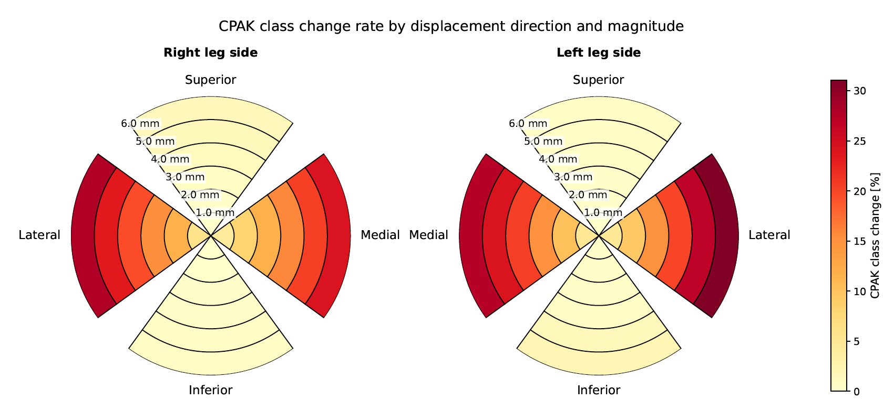

# SIAMESE_QC

<p align="center">
  <!-- <a href="<PAPER_OR_PROJECT_URL>">-B31B1B.svg" alt="Paper"></a> -->
  <a href="https://github.com/ETRO-MIT/SIAMESE_QC?tab=Apache-2.0-1-ov-file">-blue.svg" alt="License"></a>

</p>


<p align="center">
  
</p>

## Table of Contents

- [About](#about) <!-- - [Citation](#citation) -->
- [Repository Structure](#repository-structure)
- [Installing Dependencies](#installing-dependencies)
- [Quickstart](#quickstart)
- [Results](#results)
- [License](#license)
- [Contact](#contact) <!-- - [Acknowledgements](#acknowledgements) -->
- [Disclaimer](#disclaimer)


## About

Automatic landmark detection is increasingly adopted in medical imaging, yet erroneous predictions remain common, requiring expert review. This repository provides a Siamese network-based quality control framework identifies inaccurate landmark detections and estimates the magnitude of their localization errors. 

Using a contrastive loss, the network learns a shared embedding space from image-patch pairs sampled near and far from the ground-truth position. During inference, test-patch embeddings are compared to 𝐾 nearest reference embeddings using a similarity metric to determine landmark correctness and estimate distance to the ground-truth position. 

This repository provides:

- Inference code for quality control of supplied femoral trochlear notch detections in full-leg radiographs; landmark coordinates must be provided by an external detector.
- Three inference methods: Siamese embedding comparison against a reference library (LoE), direct error regression, and inaccurate-detection classification.
- Image preprocessing and patch extraction, with outputs including QC scores, review flags, and supported localization-error estimates.


<!-- ## Citation
<!-- TODO: Add the project's BibTeX citation and publication details. 

If you use this code, data, or models, please cite:

```bibtex
<PASTE_BIBTEX_ENTRY_HERE>
```

Project publication: [<PAPER_TITLE>](<PAPER_OR_PROJECT_URL>) -->


## Repository Structure

```text
.
├── assets/
├── src/
│   ├── siamese_qc/
│   │   ├── __init__.py
│   │   ├── __main__.py
│   │   ├── assets.py
│   │   ├── inference.py
│   │   ├── models.py
│   │   ├── pipeline.py
│   │   └── preprocessing.py
│   └── tools/
│       └── download_assets.py
├── .gitignore
├── changelog.md
├── README.md
├── pyproject.toml
└── requirements.txt
```

## Installing Dependencies

Clone the repository and create the test environment:

```bash
python -m venv .venv
source .venv/bin/activate       # Linux/macOS
# .venv\\Scripts\\activate     # Windows
```
Install the package from the repository root:

```bash
python -m pip install -e .
```

To install minimum dependencies:

```
python -m pip install --upgrade pip
pip install -r requirements.txt
```

## Quickstart

Before running inference, provide:

- A full-leg radiograph ; the repository does not include radiographs.
- Landmark coordinates and knee bounding boxes produced by an external detector, saved as `detections.csv` in the original image's pixel coordinates.

For example, `detections.csv` should contain:

```csv
id,x,y,xmin,ymin,xmax,ymax,side
right_notch,850,2100,650,1850,1100,2350,right
left_notch,1800,2105,1550,1850,2050,2350,left
```

- A compatible regression checkpoint at the path passed to `--weights`. Checkpoints are not included in this code repository.

Run regression inference, replace the example image and checkpoint paths with your files:

```bash
python -m siamese_qc --method regression --weights weights/regression.pth --image full_leg.mha --points detections.csv --intensity-divisor 255 --output outputs/regression.csv
```

For raster images or images without calibrated spacing metadata, provide `--spacing SX SY` (in mm/pixel) or `--condyles`
with the bilateral condylar endpoint coordinates. The output CSV preserves the input rows and adds the QC score and
decision; `inaccurate=True` means the detection should be flagged for review.

## Results


The approach was evaluated on full-leg radiographs targeting the femoral trochlear notch, optimized key hyperparameters, and compared via two inference strategies: 

- A library of embeddings from patches sampled at known distances from the ground truth 
- Reference embeddings derived from landmark-centered patches. 

The clinical relevance of localization errors was assessed using directional landmark perturbations and a sensitivity analysis of phenotype assignment. 

The performance of the LoE methodology is illustrated in the figure below. The landmark-detection algorithm achieved high accuracy, with a median Euclidean distance
error of 1.00 mm (IQR: 0.73–1.32 mm).

<p align="center">
  
</p>

Below figure shows the highest CPAK class-change
rates on both leg sides. 

<p align="center">
  
</p>


## License

The code is released under [Apache License 2.0](https://www.apache.org/licenses/LICENSE-2.0)


## Contact

- Maintainer: Sebastian Amador Sanchez
- Department: [ETRO, Vrije Universiteit Brussel](https://www.etrovub.be/)
- Email: sebastian.amador.sanchez@vub.be


<!-- ## Acknowledgements
<!-- TODO: Add funding, collaborators, and their contributions, or remove this section.
<p align="left">
  
</p>

This work was supported by <FUNDING_BODY_OR_PROJECT>.

We thank <COLLABORATORS_OR_INSTITUTIONS> for <CONTRIBUTION_DESCRIPTION>. -->


## Disclaimer

- Active maintenance of this repository is not guaranteed.
- The provided models/code are intended for research purposes only and have not been validated for clinical or commercial use.
