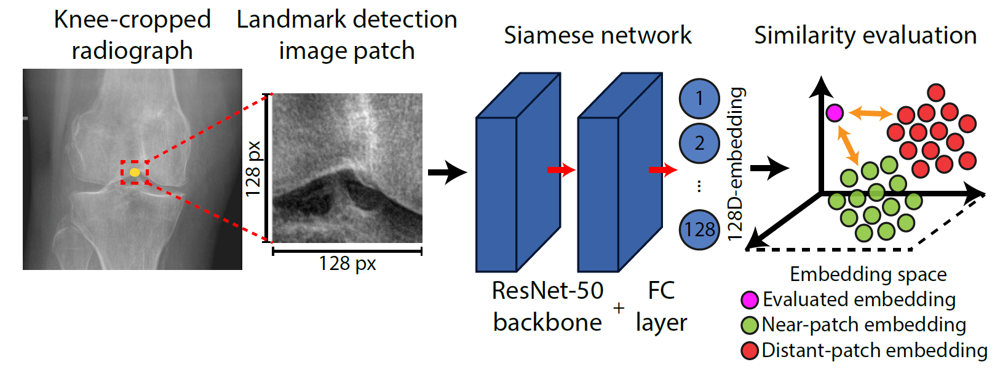
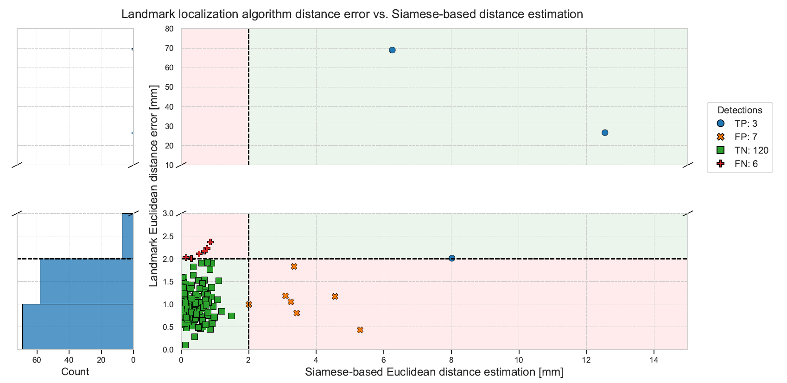

# SIAMESE_QC

<p align="center">
  <a href="https://www.sciencedirect.com/science/article/pii/S0952197626029659"></a>
  <a href="https://github.com/ETRO-MIT/SIAMESE_QC?tab=Apache-2.0-1-ov-file"></a>

</p>


<p align="center">
  
</p>

## Table of Contents

- [About](#about) 
- [Citation](#citation)
- [Tested Environment](#tested-environment)
- [Repository Structure](#repository-structure)
- [Installing Dependencies](#installing-dependencies)
- [Quickstart](#quickstart)
- [Results](#results)
- [License](#license)
- [Contact](#contact) 
- [Acknowledgements](#acknowledgements)
- [Disclaimer](#disclaimer)


## About

Automatic landmark detection is increasingly adopted in medical imaging, yet erroneous predictions remain common, requiring expert review. This repository provides a Siamese network-based quality control framework identifies inaccurate landmark detections and estimates the magnitude of their localization errors. 

Using a contrastive loss, the network learns a shared embedding space from image-patch pairs sampled near and far from the ground-truth position. During inference, test-patch embeddings are compared to 𝐾 nearest reference embeddings using a similarity metric to determine landmark correctness and estimate distance to the ground-truth position. 

This repository provides:

- Inference code for quality control of supplied femoral trochlear notch detections in full-leg radiographs; landmark coordinates must be provided by an [external detector](https://github.com/ETRO-MIT/LowerLimbMalalignment-SGR).
- Three inference methods: Siamese embedding comparison against a reference library (LoE), direct error regression, and inaccurate-detection classification.
- Image preprocessing and patch extraction, with outputs including QC scores, review flags, and supported localization-error estimates.


## Citation

If you use this code, please cite:

```bibtex
@article{AMADORSANCHEZ2027116681,
title = {Quality control of anatomical landmark detection in lower-limb radiographs using Siamese similarity-embedding comparisons},
journal = {Engineering Applications of Artificial Intelligence},
volume = {187},
pages = {116681},
year = {2027},
issn = {0952-1976},
doi = {https://doi.org/10.1016/j.engappai.2026.116681},
url = {https://www.sciencedirect.com/science/article/pii/S0952197626029659},
author = {Sebastián {Amador Sánchez} and Philippe {Van Overschelde} and Jef Vandemeulebroucke},
```

Project publication: [Quality control of anatomical landmark detection in lower-limb radiographs using Siamese similarity-embedding comparisons](https://www.sciencedirect.com/science/article/pii/S0952197626029659)


## Tested Environment

| Component | Version |
| --- | --- |
| Operating system | macOS/Linux |
| Python | >=3.10 |
| PyTorch | >=2.2 |
| SimpleITK | >=2.4.0 |

For the complete dependency list, see pyproject.toml or requirements.txt.

## Repository Structure

```text
.
├── assets/
├── src/
│   ├── siamese_qc/
│   │   ├── __init__.py
│   │   ├── __main__.py
│   │   ├── assets.py
│   │   ├── inference.py
│   │   ├── models.py
│   │   ├── pipeline.py
│   │   └── preprocessing.py
│   └── tools/
│       └── download_assets.py
├── .gitignore
├── changelog.md
├── README.md
├── pyproject.toml
└── requirements.txt
```

## Installing Dependencies

Clone the repository and create the test environment:

```bash
python -m venv .venv
source .venv/bin/activate       # Linux/macOS
```
Install the package from the repository root:

```bash
python -m pip install -e .
```

To install minimum dependencies:

```
python -m pip install --upgrade pip
pip install -r requirements.txt
```

Place the following assets in `weights/` for local inference. Use the following directory structure (filenames are the 
proposed release names):

```text
weights/
├── Siamese/
│   ├── Weights/
│   │   └── siamese_euclidean_2p5mm.pth
│   └── Library/
│       └── loe_euclidean.parquet
├── Classification/
│   ├── Weights/
│   │   └── classification.pth
│   └── Isotonic weights/
│       └── classification_calibration.json
└── Regression/
    └── Weights/
        └── regression.pth
```

| Method          | Required assets                                                                    |
|-----------------|------------------------------------------------------------------------------------|
| LoE (Euclidean) | `siamese_euclidean_2p5mm.pth` and `loe_euclidean.parquet`                          |
| Regression      | `regression.pth`                                                                   |
| Classification  | `classification.pth`; add `classification_calibration.json` for distance estimates |

The three checkpoints and supplementary files will be supplied through Hugging Face. Be sure to add each element on the 
corresponding directory.  


## Quickstart

Before running inference, provide:

- A full-leg radiograph ; the repository does not include radiographs.
- Landmark coordinates and knee bounding boxes produced by an [external detector](https://github.com/ETRO-MIT/LowerLimbMalalignment-SGR), saved as `detections.csv` in the original image's pixel coordinates.

For example, `detections.csv` should contain:

```csv
id,x,y,xmin,ymin,xmax,ymax,side
right_notch,850,2100,650,1850,1100,2350,right
left_notch,1800,2105,1550,1850,2050,2350,left
```

- A compatible regression checkpoint at the path passed to `--weights`. Checkpoints are not included in this code repository.

Run regression inference, replace the example image and checkpoint paths with your files:

```bash
python -m siamese_qc --method regression --weights weights/regression.pth --image full_leg.mha --points detections.csv --intensity-divisor 255 --output outputs/regression.csv
```

For raster images or images without calibrated spacing metadata, provide `--spacing SX SY` (in mm/pixel) or `--condyles`
with the bilateral condylar endpoint coordinates. The output CSV preserves the input rows and adds the QC score and
decision; `inaccurate=True` means the detection should be flagged for review.

### Running the demo

[`demo.py`](demo.py) runs quality control on both knees of publicly available case `34_0` of Mendeley dataset. 

Download the radiograph from the [Mendeley dataset](https://data.mendeley.com/datasets/bpvj6xczm2/3) and place the original grayscale image at `examples/34_0.png`, or pass its path with `--image`.

Do not resize, crop, mirror, or rotate the image. The demo expects the original 2860 x 6951 pixel image because its
built-in landmark coordinates and knee regions refer to that image.

The required model assets must already be placed in `weights/`:

- LoE: `weights/Siamese/Weights/siamese_euclidean_2p5mm.pth` and
  `weights/Siamese/Library/loe_euclidean.parquet`
- Regression: `weights/Regression/Weights/regression.pth`
- Classification: `weights/Classification/Weights/classification.pth`

From the repository root, view the available options and run the default LoE demo:

```bash
python demo.py --help
python demo.py --method loe --device cpu
```

To use a different image or override an asset path:

```bash
python demo.py --image /path/to/34_0.png --method loe --device cpu
python demo.py --method regression --weights /path/to/regression.pth --device cpu
python demo.py --method classification --weights /path/to/classification.pth --device cpu
```

For classification, optional calibration can be supplied with `--calibration /path/to/classification_calibration.json`.
The demo estimates spacing from the built-in bilateral condylar coordinates and writes the knee results to
`outputs/demo.csv` by default. Use `--output /path/to/results.csv` to choose another output file.

## Results

The approach was evaluated on full-leg radiographs targeting the femoral trochlear notch, optimized key hyperparameters, and compared via two inference strategies: 

- A library of embeddings from patches sampled at known distances from the ground truth 
- Reference embeddings derived from landmark-centered patches. 

The clinical relevance of localization errors was assessed using directional landmark perturbations and a sensitivity analysis of phenotype assignment. 

The performance of the LoE methodology is illustrated in the figure below. The landmark-detection algorithm achieved high accuracy, with a median Euclidean distance
error of 1.00 mm (IQR: 0.73–1.32 mm).

<figure style="text-align: center;">
  
  <figcaption><strong>Figure 1:</strong>Comparison of the Euclidean localization error produced by the landmark detection algorithm (y-axis) with the
  distance estimated by the Siamese network using the Library of embeddings (x-axis).</figcaption>
</figure>

Below figure shows the highest CPAK class-change
rates on both leg sides. 

<figure style="text-align: center;">
  
  <figcaption><strong>Figure 2:</strong> CPAK class-change rate following controlled displacement of the ground-truth femoral trochlear notch. Medial
  and lateral perturbations produced more class changes than superior and inferior perturbations, with changes exceeding
  10% of cases at 2.0 mm.</figcaption>
</figure>


## License

The code is released under [Apache License 2.0](https://www.apache.org/licenses/LICENSE-2.0)


## Contact

- Maintainer: Sebastian Amador Sanchez
- Department: [ETRO, Vrije Universiteit Brussel](https://www.etrovub.be/)
- Email: sebastian.amador.sanchez@vub.be


## Acknowledgements

<p align="left">
  
</p>

The presented job was funded by the Innoviris grant [BHF / 2020-RDIR-6a] of the Brussels-Capital Region, as part of the project ANTICIPATE on Augmented Intelligence in Orthopaedics Treatments. All authors approved the version of the manuscript to be published.


## Disclaimer

- Active maintenance of this repository is not guaranteed.
- The provided models/code are intended for research purposes only and have not been validated for clinical or commercial use.
